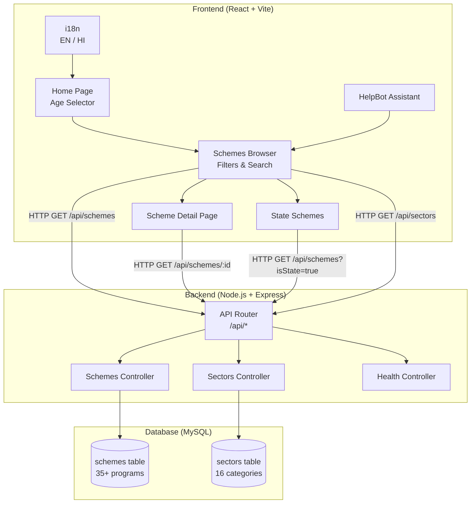
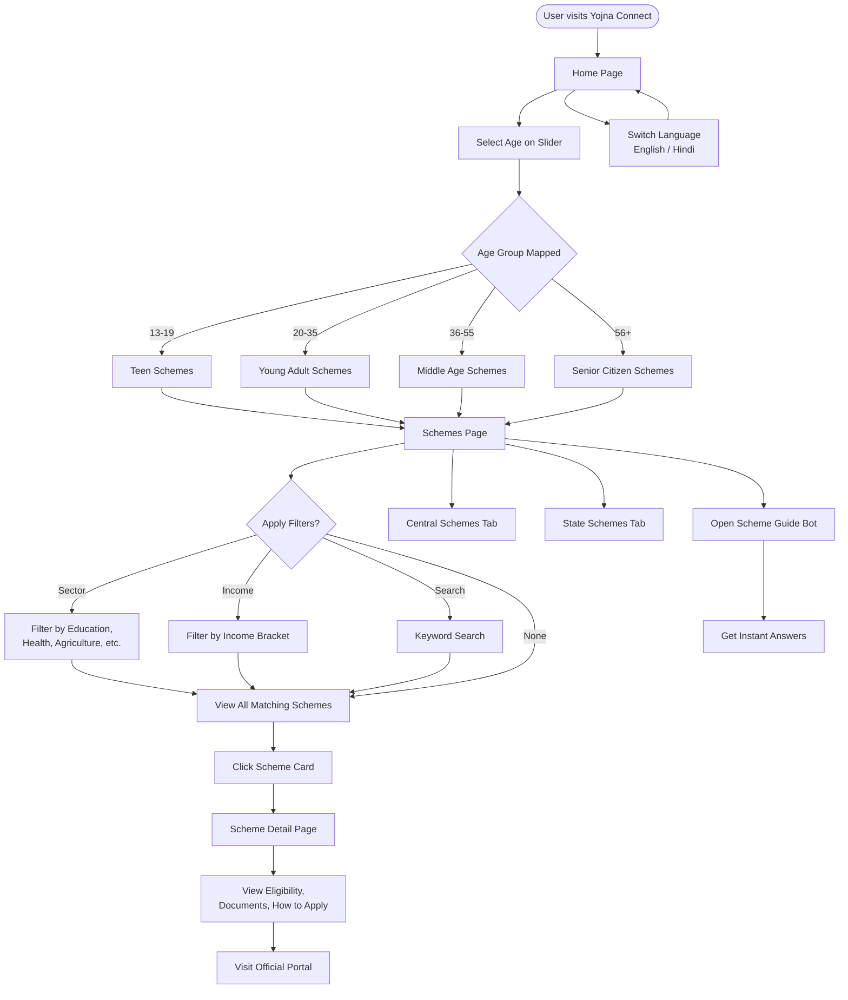
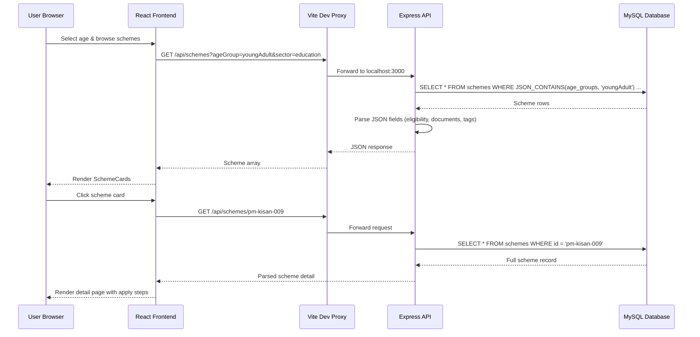
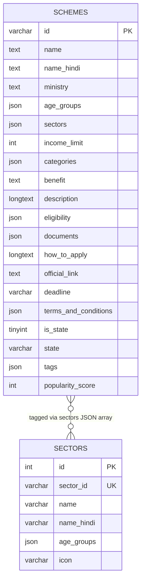

# Yojna Connect

> **Bridging India's Welfare Gap — One Scheme at a Time**

A full-stack civic technology platform that helps Indian citizens discover, explore, and apply for central and state government welfare schemes based on age, income, sector, and eligibility criteria.

**Developed by [Pawani Sharma](https://github.com/pawani-2502)**

---

## Table of Contents

- [Problem Statement](#problem-statement)
- [Solution](#solution)
- [Key Features](#key-features)
- [System Architecture](#system-architecture)
- [User Flow](#user-flow)
- [Data Flow](#data-flow)
- [Tech Stack](#tech-stack)
- [Project Structure](#project-structure)
- [Database Schema](#database-schema)
- [API Reference](#api-reference)
- [Getting Started](#getting-started)
- [Environment Variables](#environment-variables)
- [Available Scripts](#available-scripts)
- [Production Build](#production-build)
- [Screenshots](#screenshots)
- [Future Roadmap](#future-roadmap)
- [Contributing](#contributing)
- [License](#license)
- [Author](#author)

---

## Problem Statement

India runs **400+ central and state government welfare schemes** covering education, healthcare, agriculture, housing, pensions, and entrepreneurship. Despite this, millions of eligible citizens never benefit because:

- Scheme information is scattered across dozens of ministry websites
- Eligibility criteria are complex and written in bureaucratic language
- Rural and semi-urban populations lack digital literacy to navigate portals
- Language barriers (Hindi/English) exclude non-English speakers
- No single platform offers personalized, age-aware scheme discovery

**Yojna Connect** solves this by providing a unified, bilingual, mobile-friendly portal where any citizen can find schemes they qualify for in under 60 seconds.

---

## Solution

Yojna Connect is a **Government Scheme Discovery Platform** that:

1. Asks the user their age and maps them to a life-stage group (Teen, Young Adult, Middle Age, Senior)
2. Surfaces personalized scheme lists filtered by sector, income, and search keywords
3. Shows complete scheme details — eligibility, documents, application steps, deadlines, and official links
4. Offers a built-in **Scheme Guide chatbot** for instant answers on popular programs
5. Supports **English and Hindi** for wider accessibility

---

## Key Features

| Feature | Description |
|---------|-------------|
| **Age-Based Discovery** | Personalized scheme lists for teens (13–19), young adults (20–35), middle-aged (36–55), and senior citizens (56+) |
| **Smart Search & Filters** | Filter by sector, income bracket, central/state programs, and keyword search |
| **Scheme Detail Pages** | Full eligibility criteria, required documents, step-by-step application guide, official links |
| **Popular Schemes** | Top-ranked schemes surfaced by popularity score per age group |
| **Central & State Schemes** | Separate views for nationwide central programs and state-specific schemes |
| **Scheme Guide (HelpBot)** | Interactive assistant with quick answers on Ayushman Bharat, PM Kisan, Mudra, scholarships, and more |
| **Bilingual UI** | Full English and Hindi interface via i18next |
| **Platform Statistics** | Live counts of total, central, and state schemes |
| **REST API** | Clean backend API for schemes, sectors, and health checks |
| **Responsive Design** | Mobile-first UI built with Tailwind CSS and Radix UI components |

---

## System Architecture



---

## User Flow



---

## Data Flow



---

## Tech Stack

| Layer | Technologies |
|-------|-------------|
| **Frontend** | React 19, TypeScript, Vite, Tailwind CSS v4, Radix UI, TanStack Query, Wouter, i18next, Framer Motion |
| **Backend** | Node.js, Express.js 5, mysql2 |
| **Database** | MySQL 8+ with JSON columns for flexible scheme metadata |
| **Tooling** | pnpm workspaces, TypeScript, Prettier, Concurrently |
| **UI Components** | shadcn/ui (Radix + Tailwind) |

---

## Project Structure

```
yojna-connect/
├── frontend/                  # React + TypeScript SPA
│   ├── src/
│   │   ├── pages/             # Home, Schemes, SchemeDetail, StateSchemes, About
│   │   ├── components/        # SchemeCard, HelpBot, UI primitives
│   │   ├── layouts/           # Navbar, Footer
│   │   ├── services/api/      # API client & generated types
│   │   ├── hooks/             # useAgeGroup, useToast, useMobile
│   │   └── utils/             # i18n, utility helpers
│   ├── public/                # Static assets
│   └── vite.config.ts         # Dev server + API proxy
│
├── backend/                   # Express REST API
│   ├── routes/                # healthRoutes, schemesRoutes, sectorsRoutes
│   ├── controllers/           # Business logic for schemes & sectors
│   ├── config/                # MySQL connection pool
│   └── utils/                 # JSON field parsers
│
├── database/
│   └── yojanaconnect.sql      # Schema + 35 seed schemes + 16 sectors
│
├── docs/
│   └── SETUP.md               # Detailed setup guide
│
├── package.json               # Root workspace scripts
├── pnpm-workspace.yaml        # Monorepo configuration
└── README.md                  # You are here
```

---

## Database Schema



### Seed Data Included

- **35 central government schemes** — PM Kisan, Ayushman Bharat, PM Awas Yojana, Mudra, Ujjwala, scholarships, pensions, and more
- **16 sector categories** — Education, Health Insurance, Agriculture, Housing, Pension, Sports, etc.

---

## API Reference

| Method | Endpoint | Query Parameters | Description |
|--------|----------|-----------------|-------------|
| `GET` | `/api/healthz` | — | Health check |
| `GET` | `/api/schemes` | `ageGroup`, `sector`, `incomeLimit`, `isState`, `search` | List schemes with filters |
| `GET` | `/api/schemes/:id` | — | Get full scheme details |
| `GET` | `/api/schemes/:id/related` | — | Get 6 related schemes |
| `GET` | `/api/schemes/stats` | — | Total, central, and state scheme counts |
| `GET` | `/api/schemes/popular` | `limit`, `ageGroup` | Top schemes by popularity score |
| `GET` | `/api/sectors` | `ageGroup` | List sector categories |

### Example Requests

```bash
# List schemes for young adults in education sector
curl "http://localhost:3000/api/schemes?ageGroup=youngAdult&sector=education"

# Get Ayushman Bharat details
curl "http://localhost:3000/api/schemes/ayushman-bharat-008"

# Platform statistics
curl "http://localhost:3000/api/schemes/stats"
```

---

## Getting Started

### Prerequisites

- **Node.js** 20 or higher
- **pnpm** 9 or higher (`npm install -g pnpm`)
- **MySQL** 8 or higher

### Installation

**1. Clone the repository**

```bash
git clone https://github.com/pawani-2502/yojna-connect.git
cd yojna-connect
```

**2. Install dependencies**

```bash
pnpm install
```

**3. Set up the database**

```bash
mysql -u root -p -e "CREATE DATABASE IF NOT EXISTS yojanaconnect;"
mysql -u root -p yojanaconnect < database/yojanaconnect.sql
```

**4. Configure environment variables**

```bash
cp backend/.env.example backend/.env
```

Edit `backend/.env` with your MySQL credentials:

```env
PORT=3000
DB_HOST=localhost
DB_PORT=3306
DB_USER=root
DB_PASSWORD=your_password
DB_NAME=yojanaconnect
```

**5. Start development servers**

```bash
pnpm dev
```

| Service | URL |
|---------|-----|
| Frontend | http://localhost:5173 |
| Backend API | http://localhost:3000 |
| Health Check | http://localhost:3000/api/healthz |

---

## Environment Variables

| Variable | Location | Default | Description |
|----------|----------|---------|-------------|
| `PORT` | `backend/.env` | `3000` | Express server port |
| `DB_HOST` | `backend/.env` | `localhost` | MySQL host |
| `DB_PORT` | `backend/.env` | `3306` | MySQL port |
| `DB_USER` | `backend/.env` | `root` | MySQL username |
| `DB_PASSWORD` | `backend/.env` | _(empty)_ | MySQL password |
| `DB_NAME` | `backend/.env` | `yojanaconnect` | Database name |

---

## Available Scripts

| Command | Description |
|---------|-------------|
| `pnpm dev` | Start frontend and backend concurrently |
| `pnpm frontend` | Start Vite dev server only |
| `pnpm backend` | Start Express API server only |
| `pnpm build` | Typecheck and build all packages |
| `pnpm typecheck` | Run TypeScript checks across workspace |
| `pnpm frontend:build` | Build frontend for production |

---

## Production Build

```bash
pnpm build
```

Frontend production output is written to `frontend/dist/`. Serve it with any static file server and point API requests to your deployed backend.

For detailed setup instructions, see [docs/SETUP.md](docs/SETUP.md).

---

## Screenshots

| Home — Age Selector | Schemes Browser | Scheme Detail |
|:---:|:---:|:---:|
| _Personalized age-based entry point_ | _Filter by sector, income, search_ | _Full eligibility & apply guide_ |

| Scheme Guide Bot | Bilingual UI | About Page |
|:---:|:---:|:---:|
| _Instant answers on welfare programs_ | _English & Hindi support_ | _Platform overview & developer info_ |

---

## Future Roadmap

- [ ] User accounts with saved scheme bookmarks
- [ ] WhatsApp share for scheme details (family outreach)
- [ ] Offline mode with service workers for rural connectivity
- [ ] State-wise scheme expansion (all 28 states + 8 UTs)
- [ ] Eligibility quiz wizard (income + category + location)
- [ ] Application deadline reminders via email/SMS
- [ ] Admin panel for scheme data management
- [ ] Voice-based scheme search in Hindi

---

## Contributing

Contributions are welcome! To contribute:

1. Fork the repository
2. Create a feature branch: `git checkout -b feature/your-feature`
3. Commit your changes: `git commit -m "Add your feature"`
4. Push to the branch: `git push origin feature/your-feature`
5. Open a Pull Request

Please ensure your code passes `pnpm typecheck` before submitting.

---

## License

This project is licensed under the **MIT License**. See the [LICENSE](LICENSE) file for details.

---

## Author

**Pawani Sharma**

Full-Stack Developer passionate about civic technology and building accessible digital solutions for India.

- GitHub: [@pawani-2502](https://github.com/pawani-2502)

---

<p align="center">
  <strong>Yojna Connect</strong> — Empowering every Indian citizen to discover the welfare schemes they deserve.
  <br />
  Built with ❤️ by <a href="https://github.com/pawani-2502">Pawani Sharma</a>
</p>
